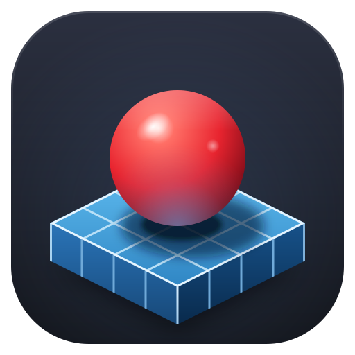

# Ballest Editor

A CAD-style map editor for [_Ballest of Them All_](https://store.steampowered.com/app/3339810), for people building large, precise tracks. It saves the game's own `.balledit` JSON, so a map made here opens in the in-game editor and publishes to the Workshop through the game.

Ballest Editor is a desktop app for Windows and Linux.

## Install

1. Open the [releases page](https://github.com/ballest-editor/ballest-editor/releases) and find the newest entry called **Ballest Editor**. Entries called **Asset pack** are build inputs, not the app. Every release so far is a prerelease, so none is marked Latest.
2. On Windows, download the `.exe` and run it. The installer isn't signed yet, so SmartScreen warns you; choose More info, then Run anyway.
3. On Linux, download the `.AppImage`, make it executable with `chmod +x`, and run it. On NixOS, start it with `appimage-run`. An update replaces the file in place as long as its name has no version in it, so keep the name it downloads with, or another without a version.

The app finds the game through Steam, and Settings › Game shows what it found. If something is missing on the first launch, a dialog says what. Exporting a map needs the game's maps folder, which the game creates the first time it runs. The Play button also needs the [Ballest plugin manager](https://anythinggoes-ballest.github.io/ballest-plugin-manager/) and the editor plugin, which Settings › Game installs for you.

Installed copies check for new releases and offer them in the status bar.

## Build from source

You need Git, Node.js 22.18 or newer and pnpm. `corepack enable` gives you the pnpm version the repository pins. The game is optional: without it, the first run downloads the asset pack (the game's meshes and textures, about 48 MB) from GitHub.

```sh
git clone https://github.com/ballest-editor/ballest-editor
cd ballest-editor
corepack enable
pnpm install
pnpm dev:desktop
```

`pnpm dev:desktop` opens the desktop app with hot reload, and Ctrl+C stops it. The first launch also downloads Electron (about 100 MB). With Nix, `nix develop` gives you Node and pnpm instead.

| Command                                | Does                                                          |
| -------------------------------------- | ------------------------------------------------------------- |
| `pnpm dev:desktop`                     | Runs the desktop app against the dev server                   |
| `pnpm dev`                             | Runs the web review build in a browser, at the port it prints |
| `pnpm build`                           | Builds every package                                          |
| `pnpm --filter @ballest/desktop start` | Runs the desktop app from that build, without packaging it    |
| `pnpm dist:desktop:linux`, `:win`      | Packages an AppImage or a Windows installer into `release/`   |
| `pnpm check:everything`                | Runs what CI runs; it must pass before you commit             |

Read [AGENTS.md](AGENTS.md) before you change anything. It holds the ground rules, the repository layout and the conventions, for people and coding agents alike.

## Web review build

The web review build is the same editor in a browser, without anything that needs the game. It exists so that a change can be tried without installing anything, and it isn't a product. Vercel deploys it for each pull request and for `main`, and those deployments need a Vercel login with access to the project. Anyone can run it locally with `pnpm dev`.

## Documentation

| Read                                                                   | For                                                                           |
| ---------------------------------------------------------------------- | ----------------------------------------------------------------------------- |
| [docs/VISION.md](docs/VISION.md)                                       | Why the editor exists, what's built and what's next                           |
| [docs/FORMAT.md](docs/FORMAT.md)                                       | The map format, the game's limits and validation rules, where files live      |
| [docs/PROJECTS.md](docs/PROJECTS.md)                                   | Projects, maps and exports: the model, the files on disk, the design to come  |
| [docs/DESKTOP.md](docs/DESKTOP.md)                                     | How the desktop app behaves and why                                           |
| [docs/DRIVER.md](docs/DRIVER.md)                                       | The game driver: its design and what was measured                             |
| [docs/design/ui-system.md](docs/design/ui-system.md)                   | The UI's type, greys, radii and spacing: the one system every view follows    |
| [docs/qa](docs/qa)                                                     | What was measured in the game, case by case                                   |
| [apps/web/README.md](apps/web/README.md)                               | The editor itself: scene, gizmos, materials, keybinds, coordinates            |
| [apps/desktop/README.md](apps/desktop/README.md)                       | The main process: developing it, IPC, the protocol handler, updates, security |
| [packages/ballest-editor-link](packages/ballest-editor-link/README.md) | The editor plugin and `play.json`                                             |
| [packages/ballest-driver](packages/ballest-driver/README.md)           | The driver plugin                                                             |
| [tools/extract](tools/extract/README.md)                               | Getting meshes, the catalog, keybinds and materials out of the game           |
| [tools/compress](tools/compress/README.md)                             | The asset pack                                                                |
| [tools/release](tools/release/README.md)                               | Installers and releases                                                       |
| [tools/driver](tools/driver/README.md)                                 | Running the game driver                                                       |
| [tools/map](tools/map/README.md)                                       | Inspecting, validating, diffing and generating maps                           |

## Notice

The game, its name and its content belong to its developers. The code is under the [MIT License](LICENSE). [NOTICE.md](NOTICE.md) says what this repository includes from the game and from Workshop creators, which that license doesn't cover.
