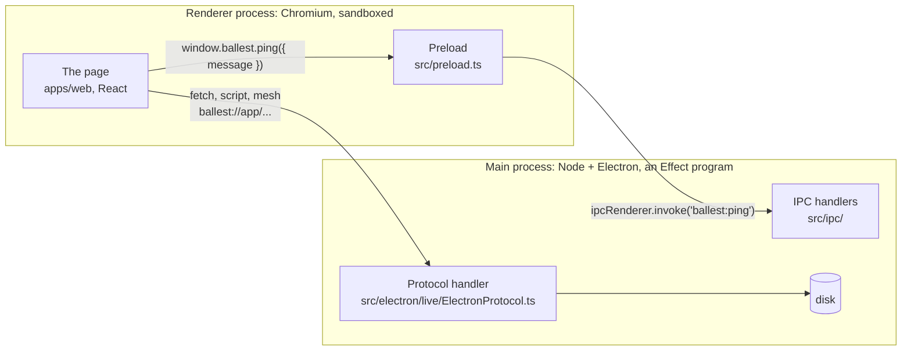
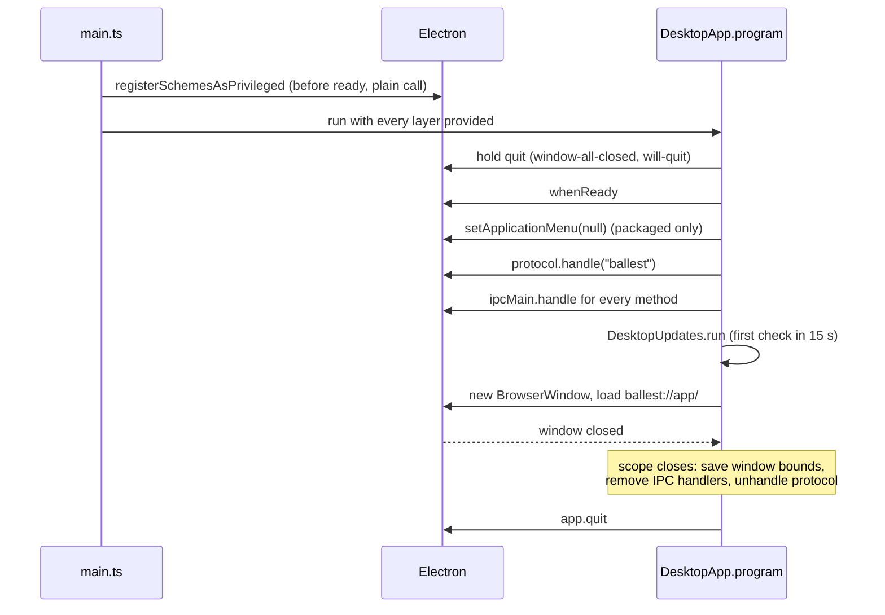
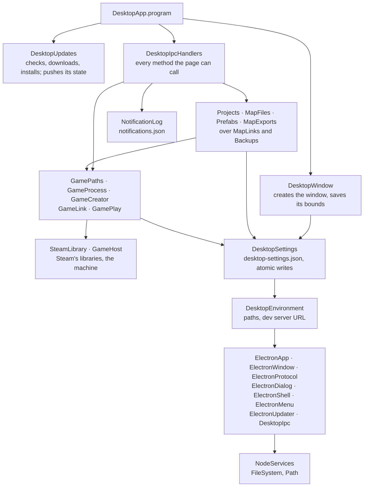

# apps/desktop

The Electron main process and preload around the editor. It opens a window, serves the editor's build into it, and gives the page a small, typed API for what a browser can't do: files, the game, the shell. The editor itself is `apps/web`, and nothing React lives here. [docs/DESKTOP.md](../../docs/DESKTOP.md) describes how the app behaves and why; this page describes how it's built.

## Develop

From the repo root:

```sh
pnpm dev:desktop    # Vite for the page, a watch build for main and preload, and Electron
```

Edits to the page hot-reload in the window. Edits under `src/` here rebuild `main.cjs` or `preload.cjs`, and Electron restarts if their bytes changed. Unsaved edits are kept through a restart ([docs/DESKTOP.md § Recovery](../../docs/DESKTOP.md#recovery)). Quitting the app (closing its last window, or Ctrl+Q) ends `pnpm dev:desktop`, as does Ctrl+C. If the main process crashes instead, the session stays up and Electron starts again on the next change to main or preload.

Or run it against a production build:

```sh
pnpm build                              # apps/web/dist, then dist-electron/
pnpm --filter @ballest/desktop start    # downloads the Electron binary on first run (~100 MB)
```

Installers (`pnpm dist:desktop:win`, `pnpm dist:desktop:linux`) and releases are [tools/release](../../tools/release/README.md)'s job.

### How the dev run fits together

`pnpm dev` and `pnpm dev:desktop` both go through `tools/dev/src/dev-runner.ts`, as in t3-code.

- **The port.** The main checkout gets 3000. A linked worktree gets a port from 3001 to 5000, hashed from its path, so it keeps its own port and its own localStorage, which the browser keys by origin, and several can run at once. `PORT=4000 pnpm dev` overrides it.
- **The environment.** The runner sets `PORT`, `HOST` and `VITE_DEV_SERVER_URL` and runs the packages' `dev` tasks through turbo with `--env-mode=loose`. Turbo's strict mode would strip those variables and the session ones Electron needs (`WAYLAND_DISPLAY`, `XDG_RUNTIME_DIR`, ...).
- **Vite.** apps/web's Vite listens on that port with `strictPort`, so a clash fails instead of moving the window onto someone else's server. It tells the HMR client the socket's host and port, which the page's own URL, `ballest-dev://app/`, doesn't have.
- **The bundles.** Main and preload are bundled to CJS with `electron` as the only external, as t3-code does. `vite build --watch` writes them, and once both are written it spawns `scripts/dev-electron.ts` over an IPC channel, so that script exits with it. It starts Electron once the bundles and the Vite port exist, and restarts it when the bytes of `main.cjs` or `preload.cjs` change. A rebuild alone doesn't: pnpm hard-links `node_modules` from one store, so a `pnpm install` in any other checkout, such as a new worktree's, touches the files this watch build follows and sets one off.
- **The profile.** `dev-electron.ts` keeps the dev profile in `apps/desktop/.dev-user-data/`, through `BALLEST_USER_DATA_DIR`, which main applies before `ready`. So worktrees don't share Chromium's storage lock.
- **`ELECTRON_RUN_AS_NODE`.** Both launchers drop it. Electron-based terminals (T3 Code, VS Code) export it, and it turns the binary into plain Node.
- **NixOS.** Electron runs through `nix-ld`, whose default libraries have no `libEGL.so.1` or `libGL.so.1`, so its GPU process exits and the page has no WebGL. When the system doesn't provide `libEGL.so.1`, both launchers build the flake's `libglvnd` and add it to `LD_LIBRARY_PATH` (`scripts/nixGl.ts`). If that fails they warn; adding `libglvnd` to `programs.nix-ld.libraries` fixes it instead.
- **DevTools.** `BALLEST_REMOTE_DEBUGGING_PORT=9222 pnpm dev:desktop` lets Chrome DevTools or a CDP script attach on that port. `pnpm --filter @ballest/desktop start` doesn't read that variable; it passes its arguments through to Electron instead, so give it `--remote-debugging-port=9222`.

### Running without a GPU

Xvfb has no GPU, so the editor can't render there as it is. Chromium logs `WebGL2 blocklisted`, three.js fails to create its context, and the editor's error boundary replaces the page ("Something went wrong"). The window, the protocol handler, IPC and the catalog fetch all still work.

A smoke check under Xvfb (#69) can assert only on those, or turn on software GL and also check that the canvas mounted. `--use-angle=swiftshader --enable-unsafe-swiftshader --ignore-gpu-blocklist` renders the editor under Xvfb. `scripts/start-electron.ts` passes its arguments through to Electron, and `scripts/dev-electron.ts` doesn't take extra flags yet.

On a Wayland desktop, Electron picks Wayland whenever `WAYLAND_DISPLAY` or `XDG_SESSION_TYPE=wayland` is set, even with `DISPLAY=:99`, and the window opens on the real screen. Unset both and set `ELECTRON_OZONE_PLATFORM_HINT=x11` to keep it on Xvfb. CI runners have no Wayland session.

## Two processes

An Electron app is two kinds of process. The main process is Node with full access to the machine. The renderer is a Chromium tab, sandboxed, with no Node and no file access. They can't call each other's functions, so they talk in two ways.



**Loading files.** The page asks for `ballest://app/assets/catalog.json` like any URL. There is no web server and no port. Chromium hands the request to a function in main, `serveStatic`, which reads the file from the editor's build and returns a `Response`. A request for a page (no file extension, or one that accepts HTML) that matches no file gets `index.html`, and the router uses hash history under Electron. A missing `.glb` gets a 404. Paths with `..` in them can't leave the directory. Responses carry a Content-Security-Policy header and a MIME type by extension.

Why not `file://`? There, `fetch("/assets/x")` resolves to the root of the disk, and every local page shares one origin. A localhost server would work too, but it can collide on a port, and any other program on the machine could connect to it.

**Doing things.** Reading a map from the game's folder or launching Steam needs Node, so the page sends main a message and waits for the answer. That is IPC. The page never sees `ipcRenderer`; it sees `window.ballest`, a plain object the preload puts there before any page script runs. `window.ballest.ping({ message: "hello" })` becomes `ipcRenderer.invoke("ballest:ping", { message: "hello" })`, main checks the payload against a schema, runs the handler and encodes the result. `ping({ message: 42 })` rejects. The object's shape is the `DesktopBridge` type, which `packages/contracts` maps from its table of methods (`DesktopMethods`), shared by all three sides.

The preload is the only code that holds `ipcRenderer`, so the page can only send the messages the bridge exposes. That is why the preload is small: a loop that forwards each method's payload, as is, to its channel in `InvokeChannels`, and subscribes to each channel in `PushChannels`.

## Two schemes

`ballest://` and `ballest-dev://` load the same app from two places.

| Scheme           | Serves                                                                               | When                              |
| ---------------- | ------------------------------------------------------------------------------------ | --------------------------------- |
| `ballest://`     | `apps/web/dist` from disk; when packaged, `app.asar`'s `web/` and `resources/assets` | the `start` script, installed app |
| `ballest-dev://` | forwards every request to the Vite dev server with `net.fetch`                       | `pnpm dev:desktop`                |

They are separate schemes because Chromium keys localStorage by origin, so a dev run can't overwrite the settings and keybinds of the installed copy. And only the production scheme turns on V8's code cache, which only pays off for files that don't change. HMR connects straight to the Vite port.

## What main does, in order

`src/app/DesktopApp.ts` is the whole program. Each step that registers something also says how to undo it, and Effect runs the undo steps in reverse when the scope closes.



If any step fails, main runs the same cleanup, shows a native error box with the cause and quits. Electron would normally quit by itself as soon as the last window closes; the two held events keep it waiting until the bounds are saved.

The scheme privileges are registered outside Effect because Electron only accepts them before `ready`, and the runtime isn't up yet.

## Services

Every Electron API we touch has a thin Effect service around it in `src/electron/` (`ElectronApp`, `ElectronWindow`, `ElectronProtocol`, `ElectronDialog`, `ElectronShell`, `ElectronMenu`, `ElectronUpdater`), and listeners are scoped with `acquireRelease`. `DesktopIpc` in `src/ipc/` does the same for `ipcMain`. Each service's tag imports only Electron's types; its layer, the code that calls Electron, is in `src/electron/live/`. Only those layers, `main.ts`, which wires them up, and the preload load `electron` at runtime, because loading it from Node downloads the binary; a lint rule holds the rest to type imports. Everything else asks for a service by name and gets a fake in tests, and a test that imports `electron` fails at once (`src/test/noElectron.ts`).

The main dependencies, simplified:



`src/main.ts` stacks these as layers (`layerDesktopRuntime`) and hands the program to `NodeRuntime.runMain`. The shape is copied from [t3-code](https://github.com/pingdotgg/t3code)'s `apps/desktop`, which runs Effect v4 in its main process the same way, at about fifty times the size.

`src/game/` holds the game's side: `SteamLibrary` finds the install from `libraryfolders.vdf` and `appmanifest_3339810.acf`, `GamePaths` the maps and plugins folders, `GameProcess` whether the game runs, `GameCreator` the Steam persona name, `GameLink` the editor plugin's status and install and `play.json`, and `GamePlay` Play: the export, the handoff, the launch and the game session after it.

`src/project/` holds the project's side: `Projects` is which project is in use (recent projects, New project, the project's name and folders, the open map), `WindowRegistry` is what the other running copies have open, `MapFiles` is its `maps/` (list, read, write, rename, import, backups), `Prefabs` is the two tiers of prefabs, and `MapExports` is Export to game, sync detection and Re-import, over `MapLinks` (`link.json`) and `Backups`. They fail with `ProjectError`, and `MapFiles` and `MapExports` also with `MapLinkError` and `BackupError`. The naming rules main and the page share (`isMapFileName`, `isProjectName`, `mapFileNameOf`, ...) are `@ballest/contracts`' `names.ts`. `MapFileName` applies `isMapFileName`, so a payload naming anything else is refused before its handler runs.

## Adding a method the page can call

A method is declared once, in `packages/contracts`, and handled once, in main. Adding `exportMap` touches three files:

1. `packages/contracts/src/channels.ts`. Its channel in `InvokeChannels`: `exportMap: "ballest:project:exportMap"`.
2. `packages/contracts/src/DesktopBridge.ts`. Its payload and result schemas, and its entry in `DesktopMethods`: `exportMap: { payload: ExportMapPayload, result: ExportMapResult }`, under the doc comment the page sees on `window.ballest.exportMap`. A method that takes nothing has `payload: noPayload`.
3. `src/ipc/methods/<area>.ts`. Its handler in the area's handlers: `exportMap: Effect.fn("ipc.exportMap")(function*(payload) { ... })`. It gets the decoded payload and the sender, returns the result before encoding, and uses whatever services it needs.

The rest follows from the table. `DesktopBridge` gets `exportMap(payload)`, the preload forwards it, `DesktopIpcHandlers.ts` builds `makeIpcMethod(name, handler)` for every entry and `DesktopIpc.handle` registers it, and the build check calls it. Typecheck fails when a channel has no schemas or the other way round, and when a method has no handler. The page reaches it through `Platform` (`apps/web/src/services/Platform.ts`), which names each method it offers.

The channels are a table of their own because the preload bundles them: `@ballest/contracts/channels` imports nothing, while the schemas would bring effect into the preload (3 kB to about 300 kB, run before every page load).

Main pushing to the page goes the other way: `webContents.send` in main (usually `ElectronWindow.sendAll`) on a channel in `PushChannels`, the value's schema in `DesktopPushes`, and a subscription the preload makes for each (`onUpdateState`, `onUnloadRequest`, `onPlaySessionEnded`).

## The preload build check

A sandboxed preload can `require` only `electron` and a few built-ins (`electron/common`, `electron/renderer`, `events`, `timers`, `url`), and it has to be one file because it can't resolve imports from inside asar. `scripts/verifyPreloadBundle.ts` runs on every `vite build`, parses `preload.cjs`, refuses any other `require` and any dynamic `import()`, then runs the bundle in a Node VM against a stub `electron` and checks `window.ballest`: the versions, each method in `InvokeChannels` invoking its channel with its payload as is, and each subscription in `PushChannels` listening on its channel until unsubscribed. Send `ping` on the wrong channel and the build fails. This is a packaging check, not a security one; anyone who can edit `preload.cjs` on disk can edit `main.cjs` too.

## Updates

An installed app updates itself from this repository's GitHub Releases. `DesktopUpdates` (`src/updates/`) checks 15 s after start and every 4 minutes until it finds a newer release, then waits for the user: the page's status bar offers it, downloads it on Download and installs it on Restart. The status bar's left end shows the running version. Help › Check for updates runs a check now, and the status bar says what it found; a check nobody asked for only speaks up when it finds a release. `electron-updater` does the work through `ElectronUpdater`; electron-builder wrote the feed into `resources/app-update.yml`.

| State         | When                                            | The page shows                                                                         |
| ------------- | ----------------------------------------------- | -------------------------------------------------------------------------------------- |
| `disabled`    | dev, unpackaged, turned off, Linux not AppImage | nothing                                                                                |
| `idle`        | up to date                                      | nothing                                                                                |
| `checking`    | a check is out                                  | nothing                                                                                |
| `error`       | the check failed (offline); the next retries    | nothing                                                                                |
| `available`   | a newer release; also after a failed download   | "Update" ("Update failed" after one), notes, Download ("Try again" after a failed one) |
| `downloading` | after Download                                  | a progress ring and "n%"                                                               |
| `ready`       | downloaded; also after a failed install         | "Restart to update", accented                                                          |

A stable install looks at stable releases only, so it never sees a release candidate. A prerelease install looks for a stable release first and takes it if it's newer, so `0.2.0-rc.2` is offered `v0.2.0`; otherwise it takes the newest tag of its own channel, if that's newer. An older stable release is never offered. `findRelease` in `ElectronUpdater` decides, with one lookup with `allowPrerelease` off and then one with it on. It stops at the first find, because `electron-updater` downloads the release its last successful find returned. Until the first stable release is out, the stable lookup fails, and that counts as finding nothing.

GitHub's atom feed lists a tag as soon as it's pushed, before its release has files. For a prerelease install that counts as nothing new, not as an error. `electron-updater` only looks at the newest tag of the channel, though, so that install isn't offered an older finished release until the new tag's release is published.

Every change goes to the page on `ballest:update:state`; the page asks for the current state once (`ballest:update:get`) when it starts listening. Release notes arrive as GitHub's HTML (a generic feed's may be plain text); `updates/releaseNotes.ts` keeps headings, paragraphs, lists, code blocks and, in their text, bold, italics, code and http(s) links, and sends them as `ReleaseNoteBlock`s. Any other element is unwrapped to its text; `script`, `style`, `iframe`, `svg` and the like go with their content, images and non-web links are dropped, and the text is capped at 4000 characters. The state also carries the release's date (from the feed) and its page (`releases/tag/v<version>`), for the popover's View on GitHub.

| Variable                          | Effect                                                               |
| --------------------------------- | -------------------------------------------------------------------- |
| `BALLEST_DISABLE_AUTO_UPDATE=1`   | no checks                                                            |
| `BALLEST_MOCK_UPDATES=1`          | checks `http://127.0.0.1:4848/` (`pnpm release:mock-server`) instead |
| `BALLEST_MOCK_UPDATE_SERVER_PORT` | that port                                                            |

On Linux an update replaces the AppImage in place, under whatever name the user gave it, as long as that name has no version ([tools/release](../../tools/release/README.md) says why). A copy saved with a versioned name (0.1.0-rc.1, rc.2) is renamed once more, to `Ballest-Editor-x86_64.AppImage`, on its next update; after that it stays put.

Trying it without a release is [tools/release](../../tools/release/README.md#trying-updates)'s job.

## Security settings

- `contextIsolation: true`, `sandbox: true`, `nodeIntegration: false`. The page and the preload run in separate JavaScript worlds, with no Node in either.
- Navigation to anything but the app's own URL goes to the system browser, and so does every `window.open`, which only lets http(s) through. No other page can load inside the window and pick up `window.ballest`.
- Main decodes every IPC payload with its schema before a handler runs.
- Map files are named by file name, never by path: a `.balledit` name with no separators, joined to the current project's `maps/` folder (Save, Rename, Import) or to the game's maps folder (Export to game). The project folder is one main made under `Documents/Ballest Editor`, or one the user picked in a folder dialog (the recent projects); `ballest:project:switch`, `ballest:project:create`, `ballest:project:check` and `ballest:project:openWindow` with any other folder are refused. Import reads only a file the user picked in its open dialog this session, so a compromised page can't read the disk.
- The game folders are only ever chosen in a dialog, never typed by the page. Reveal opens only those folders, the project folder, its `maps/` or its `.ballest/backups/`. The only writes into the game's install are the editor plugin's own folder and `play.json`.
- CSP allows scripts from the app's own origin only. `'unsafe-inline'` is still on for the inline script in `index.html` that lays out the loading skeleton; moving that script out would let us drop it.

## Layout

```
src/
  main.ts                 wires the layers, runs the program
  preload.ts              window.ballest; must stay self-contained
  app/        DesktopApp (the program), DesktopEnvironment (paths)
  electron/   one service per Electron API
  game/       SteamLibrary (Steam's libraries, the game's install), GamePaths (install, maps and plugins folders,
              overrides), locations (the path rules), GameProcess (is the game running), GameHost (the machine),
              GameCreator (the Steam persona name), GameLink (the editor plugin, play.json), pluginManifest (info.toml),
              GamePlay (Play and the game session), vdf (Steam's KeyValues format), probe, fakeSteam (tests)
  ipc/        DesktopIpc (handle + makeIpcMethod), DesktopIpcHandlers (registers every method), methods/ (the
              handlers, by area)
  notifications/ NotificationLog (notifications.json: the bell's last 100, kept for the page)
  project/    Projects (the project in use), WindowRegistry (the other running copies), windowStart (where a window
              starts), MapFiles (its maps/), Prefabs (both tiers), MapExports (Export to game, sync, Re-import), MapLinks
              (.ballest/link.json), Backups, sync (seeExport), files (atomic writes, hashes), layers
  protocol/   serveStatic: files for ballest://, no Electron import, tested
  settings/   desktop-settings.json
  updates/    DesktopUpdates (the updater: when it checks, what the page is told), updateMachine (its states),
              releaseNotes (GitHub's HTML to plain blocks)
  window/     DesktopWindow: the editor window and its bounds; chrome: title bar overlay, F11 and Ctrl+Q;
              WindowLauncher (New window), launchArgs (--project)
resources/
  icon.svg                the app icon; tools/release renders the .ico and PNGs from it
scripts/
  electron.ts             the Electron binary and its environment, minus ELECTRON_RUN_AS_NODE
  start-electron.ts       the `start` script: Electron against the production build
  dev-electron.ts         `pnpm dev:desktop`: Electron against Vite, restarted when the bundles change
  verifyPreloadBundle.ts  the build check above
```

`pnpm --filter @ballest/desktop test` runs the tests. They cover:

- the IPC methods against a fake `ipcMain` and fake dialogs: ping, the project (Save, Rename, Import from the game and elsewhere, Export to game and the published-draft check, choosing and switching projects, a project open in another window, New window), external links, the window theme, the game folders, launch
- the game lookups: vdf and manifest fixtures in `src/game/fixtures/`, Windows path rules through `node:path`'s `win32`, and a fake Steam tree and `/proc` in a temp folder
- the editor plugin's status and install, Play and the game session, the creator lookup
- backups, `link.json` and sync
- the window registry (live, crashed, cleanup), where a window starts, `--project` and how a new window is started
- file serving and path escapes, the settings file, the window shortcuts
- the updater (when it checks, download and install, failures, when it is off) and the preload check
