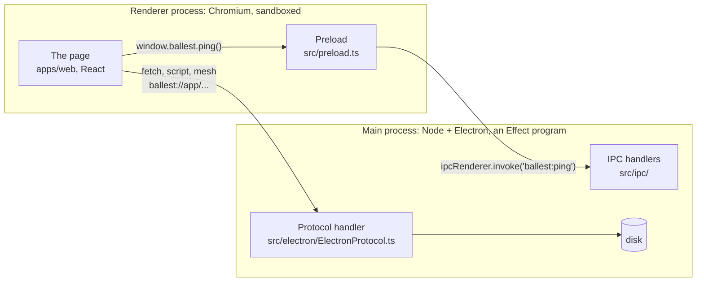
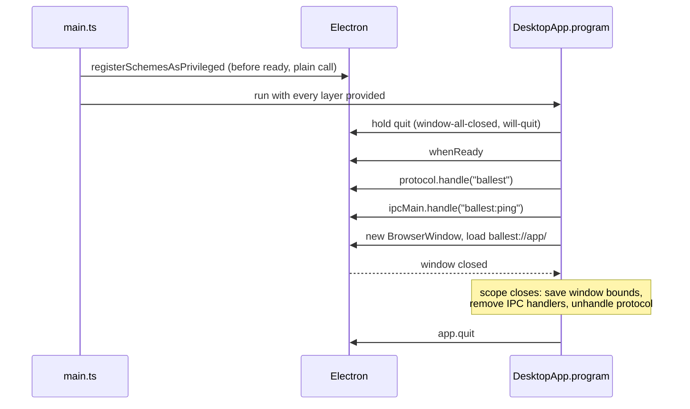
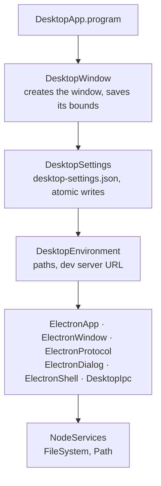

# apps/desktop

The Electron shell around the editor. It opens a window, serves the web build into it, and gives the page a small, typed API for things a browser can't do (files, the game, the shell). The editor itself is `apps/web`; nothing React lives here.

Develop it from the repo root:

```sh
pnpm dev:desktop    # Vite for the page, a watch build for main and preload, and Electron
```

Edits to the page hot-reload in the window. Edits under `src/` here rebuild `main.cjs` or `preload.cjs`, and Electron restarts. Ctrl+C stops everything. Each checkout gets its own port (3000 for the main one, a fixed one per worktree) and its own profile in `.dev-user-data/`, so worktrees can run side by side. `BALLEST_REMOTE_DEBUGGING_PORT=9222 pnpm dev:desktop` lets Chrome DevTools (or a CDP script) attach on that port.

Or run it against the production web build:

```sh
pnpm build                              # apps/web/dist, then dist-electron/
pnpm --filter @ballest/desktop start    # downloads the Electron binary on first run (~100 MB)
```

## Two processes

An Electron app is two kinds of process. The main process is Node with full access to the machine. The renderer is a Chromium tab, sandboxed, with no Node and no file access. They can't call each other's functions, so they talk in two ways.



**Loading files.** The page asks for `ballest://app/assets/catalog.json` like any URL. There is no web server and no port. Chromium hands the request to a function in main, `serveStatic`, which reads the file from `apps/web/dist` and returns a `Response`. Page routes like `/editor/settings` match no file and get `index.html`, so the router takes over. A missing `.glb` gets a 404. Paths with `..` in them can't leave the directory. Every response carries a Content-Security-Policy header.

Why not `file://`? There, `fetch("/assets/x")` resolves to the root of the disk, and every local page shares one origin. A localhost server would work too, but it can collide on a port, and any other program on the machine could connect to it.

**Doing things.** Reading a map from the game's folder or launching Steam needs Node, so the page sends main a message and waits for the answer. That is IPC. The page never sees `ipcRenderer`; it sees `window.ballest`, a plain object the preload puts there before any page script runs. `window.ballest.ping("hello")` becomes `ipcRenderer.invoke("ballest:ping", { message: "hello" })`, main checks the payload against a schema, runs the handler and encodes the result. `ping(42)` rejects. The object's shape is the `DesktopBridge` interface in `packages/contracts`, shared by all three sides.

The preload is the only code that holds `ipcRenderer`, so the page can only send the messages the bridge exposes. That is why it matters that the preload is small and hand-written.

## Two schemes

`ballest://` and `ballest-dev://` load the same app from two places.

| Scheme           | Serves                                        | When                        |
| ---------------- | --------------------------------------------- | --------------------------- |
| `ballest://`     | `apps/web/dist` from disk                     | `pnpm start`, installed app |
| `ballest-dev://` | forwards every request to the Vite dev server | `pnpm dev:desktop`          |

They are separate schemes because Chromium keys localStorage by origin. A dev run can't overwrite the settings and keybinds of the installed copy. And only the production scheme turns on V8's code cache, which only pays off for files that don't change.

## What main does, in order

`src/app/DesktopApp.ts` is the whole program. Each step that registers something also says how to undo it, and Effect runs the undo steps in reverse when the scope closes.



If any step fails, main shows a native error box with the cause, runs the same cleanup and quits. Electron would normally quit by itself as soon as the last window closes; the two held events keep it waiting until the bounds are saved.

The scheme privileges are registered outside Effect because Electron only accepts them before `ready`, and the runtime isn't up yet.

## Services

Every Electron API we touch has a thin Effect service around it in `src/electron/`. That is the only code that imports `electron` at runtime. Everything above it asks for a service by name and gets a fake in tests, which matters because requiring `electron` from Node downloads the binary.



`src/main.ts` stacks these as layers and hands the program to `NodeRuntime.runMain`. The shape is copied from [t3-code](https://github.com/pingdotgg/t3code)'s `apps/desktop`, which runs Effect v4 in its main process the same way, at about fifty times the size.

## Adding a method the page can call

One IPC method is one `makeIpcMethod`. Adding `saveToGame` touches five files:

1. `packages/contracts/src/DesktopBridge.ts`. Payload and result schemas, plus a member on the interface.
2. `src/ipc/channels.ts`. The channel name.
3. `src/ipc/methods/<area>.ts`. `makeIpcMethod({ channel, payload, result, handler })`. The handler is where the work happens, with whatever services it needs.
4. `src/ipc/DesktopIpcHandlers.ts`. One `yield* ipc.handle(saveToGame)` line.
5. `src/preload.ts`. One line forwarding to `ipcRenderer.invoke`.

The compiler catches a missing bridge member in the preload and in the build check. It doesn't catch a forgotten step 4; the call would reject with "no handler registered".

Main pushing to the page (update progress, later) goes the other way: `webContents.send` in main, and an `on`/`removeListener` pair in the preload.

## The preload build check

A sandboxed preload can `require("electron")` and nothing else, and it has to be one file. `scripts/verifyPreloadBundle.ts` runs on every `vite build`, parses `preload.cjs`, refuses any other `require` or a dynamic `import()`, then runs the bundle in a Node VM against a stub `electron` and checks that `window.ballest` has every `DesktopBridge` member. Rename `ping` in the preload and the build fails. This is a packaging check, not a security one; anyone who can edit `preload.cjs` on disk can edit `main.cjs` too.

## Security settings

- `contextIsolation`, `sandbox`, `nodeIntegration: false`. The page and the preload run in separate JavaScript worlds, with no Node in either.
- Navigation and `window.open` to anything but `ballest://app` go to the system browser. No other page can load inside the window and pick up `window.ballest`.
- Main decodes every IPC payload with its schema before a handler runs.
- CSP allows scripts from the app's own origin only. `'unsafe-inline'` is still on for the panel-width script in `index.html`; moving that script out would let us drop it.

## Layout

```
src/
  main.ts                 wires the layers, runs the program
  preload.ts              window.ballest; must stay self-contained
  app/        DesktopApp (the program), DesktopEnvironment (paths)
  electron/   one service per Electron API
  ipc/        DesktopIpc (handle + makeIpcMethod), channels, methods/
  protocol/   serveStatic: files for ballest://, no Electron import, tested
  settings/   desktop-settings.json
  window/     DesktopWindow: the editor window and its bounds
scripts/
  electron.ts             the Electron binary and its environment, minus ELECTRON_RUN_AS_NODE, which
                          Electron-based terminals export and which turns the binary into plain Node
  start-electron.ts       `pnpm start`: Electron against the production build
  dev-electron.ts         `pnpm dev:desktop`: Electron against Vite, restarted when the bundles change
  verifyPreloadBundle.ts  the build check above
```

Tests (`pnpm --filter @ballest/desktop test`) cover the ping round trip against a fake `ipcMain`, file serving and path escapes, the settings file, and the preload check. None of them load `electron`.
